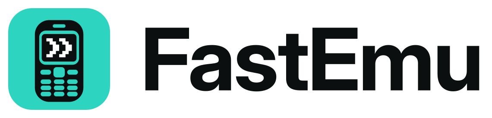
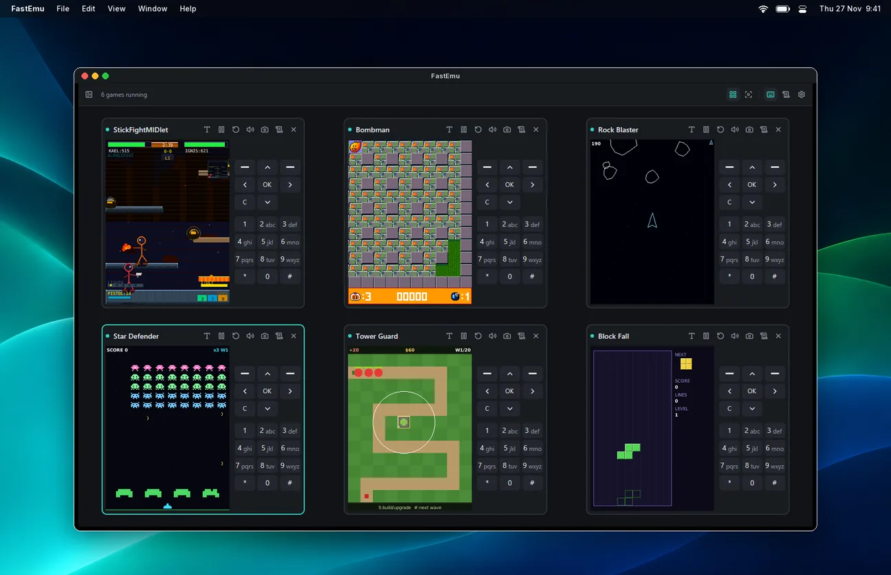
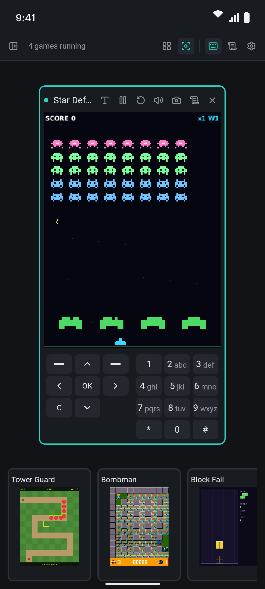

<p align="center">
  <picture>
    <source media="(prefers-color-scheme: dark)" srcset="assets/logo-dark.svg">
    <source media="(prefers-color-scheme: light)" srcset="assets/logo-light.svg">
    
  </picture>
</p>

<p align="center">
  Modern and faster version of MicroEmu and J2ME Loader with multi instances support, available in Windows, Linux, MacOS and Android built in Zed GPUI.
</p>

<p align="center">
  <a href="https://github.com/fzn0x/FastEmu/actions/workflows/ci.yml"></a>
  <a href="#lisensi"></a>
  <a href="https://fastemu.functionx.dev"></a>
</p>

---

<p align="center">
  
  
</p>

<sub>Stick Fight, BombMan, Rock Blaster, Star Defender, Tower Guard, dan
Block Fall berjalan di jendela FastEmu 0.1.0, di mock-up desktop macOS,
dan aplikasi Android di emulator Pixel 8. Lihat
[Penghargaan](#penghargaan).</sub>

FastEmu menjalankan game Java ME, yaitu file `.jar` dan `.jad` buatan
untuk ponsel tahun 2000-an, di Windows, Linux, macOS, dan Android. FastEmu
mengimplementasikan CLDC 1.1 dan MIDP 2.0 dengan mesin virtual sendiri,
jadi Java tidak perlu terpasang. Setiap game berjalan di mesin virtualnya
sendiri dengan memori, thread, data simpanan, dan suara sendiri, dan satu
jendela menampilkan sebanyak apa pun game yang Anda jalankan. Game yang
crash atau macet tidak menghentikan game di sebelahnya.

Perbandingannya dengan MicroEmulator 2.0.4 di satu PC Windows dan
dengan J2ME Loader 1.9.0 di Android, dalam waktu mulai, memori, waktu
prosesor dan banyak game sekaligus, serta bagian di mana masing-masing
lebih cepat, ada di [halaman benchmark](docs/benchmark.md).

[Pasang](#pasang) · [Penggunaan](#penggunaan) · [API yang didukung](#api-yang-didukung) ·
[Build dari sumber](#build-dari-sumber) · [Kontribusi](CONTRIBUTING.md) ·
[Changelog](CHANGELOG.md) · [English](README.md)

## Pasang

Unduh file untuk sistem Anda dari
[halaman Releases](https://github.com/fzn0x/FastEmu/releases/latest). Setiap
rilis punya file `SHA256SUMS` untuk memeriksa unduhan.

| Sistem | Caranya |
| --- | --- |
| Windows | Jalankan `fastemu-<versi>-windows-x64-setup.exe`. Penginstalnya memasang FastEmu untuk akun Anda tanpa hak administrator. FastEmu masuk ke menu Start dan ke Open with untuk file `.jar` dan `.jad`, dan Settings, Apps bisa mencopotnya. Kalau tidak mau memasang, ekstrak `fastemu-<versi>-windows-x64-portable.zip` di mana saja dan jalankan `fastemu.exe`. Jika SmartScreen memperingatkan, pilih More info, lalu Run anyway: programnya belum ditandatangani. |
| Linux | Jadikan `fastemu-<versi>-linux-x64.AppImage` bisa dieksekusi lalu jalankan. Atau pasang `fastemu-<versi>-linux-x64.deb` di Debian dan Ubuntu, atau `fastemu-<versi>-linux-x64.rpm` di Fedora dan sistem RPM lain, supaya muncul di menu. `fastemu-<versi>-linux-x64.tar.gz` bisa diekstrak di mana saja. Semuanya juga ada untuk Arm64, sebagai `-linux-arm64`. FastEmu butuh driver Vulkan dan sesi Wayland atau X11. Jika AppImage bilang FUSE tidak ada, jalankan dengan `--appimage-extract-and-run`. |
| macOS | Buka `fastemu-<versi>-macos-universal.dmg` dan seret FastEmu ke Applications. `fastemu-<versi>-macos-universal.zip` berisi aplikasi yang sama, untuk diekstrak dan dipindahkan sendiri. Aplikasinya belum dinotarisasi: buka sekali lewat System Settings, Privacy & Security, Open Anyway. |
| Android | Buka `fastemu-<versi>-android.apk` dari berkas Anda. Android akan meminta izin memasang dari sumber itu pada pertama kali. |
| Linux apa saja, dalam sandbox | Buka `fastemu-<versi>-linux-x64.flatpak` atau `-linux-arm64.flatpak` dengan pusat perangkat lunak Anda, atau jalankan `flatpak install ./fastemu-<versi>-linux-x64.flatpak`. Pertama kali, Flatpak mengambil runtime freedesktop dari Flathub. Di dalam sandbox-nya FastEmu melihat layar, suara dan jaringan, dan hanya file yang Anda pilih. |

Dari terminal, satu baris memasang rilis terbaru, setelah diperiksa
dengan `SHA256SUMS`-nya. Di Linux, FastEmu dipasang untuk akun Anda,
dengan entri menu dan perintah `fastemu` di `~/.local/bin`. Di macOS,
FastEmu.app dipasang ke Applications:

```sh
curl -fsSL https://github.com/fzn0x/FastEmu/releases/latest/download/install.sh | sh
```

Di Windows, di PowerShell, perintah ini menjalankan penginstalnya:

```powershell
irm https://github.com/fzn0x/FastEmu/releases/latest/download/install.ps1 | iex
```

`sh install.sh --uninstall` mencopot FastEmu lagi, begitu juga
`install.ps1 -Uninstall`.

Dengan pengelola paket, di macOS dengan [Homebrew](https://brew.sh):

```sh
brew install --cask fzn0x/tap/fastemu
```

Dan di Windows dengan [Scoop](https://scoop.sh):

```powershell
scoop bucket add fzn0x https://github.com/fzn0x/scoop-bucket
scoop install fastemu
```

FastEmu tidak menyertakan game. Pakai file yang Anda miliki atau yang
dibagikan gratis oleh pembuatnya.

## Penggunaan

**Menambah game.** Seret file `.jar` atau `.jad` ke jendela, pilih **+**
di atas perpustakaan, atau berikan file lewat baris perintah, yang
menambahkan lalu menjalankan setiap file:

```sh
fastemu snake.jar tetris.jad
```

Di Android, pilih **+** dan pilih file dari penyimpanan, atau buka file
dari pengelola file dengan FastEmu. FastEmu membaca nama, vendor, versi,
dan ikon dari manifes atau deskriptor, lalu menampilkan game di
perpustakaannya. Klik sebuah game untuk menjalankannya.

**Menjalankan beberapa game.** Jalankan game lain dari perpustakaan saat
satu game sedang berjalan, dan game itu terbuka di sebelahnya. Game yang
sama bisa dijalankan dua kali; setiap salinan menyimpan datanya sendiri.
Semua game memutar suaranya, dan masing-masing bisa dibisukan. Jendela
menampilkan game yang berjalan dalam kisi berukuran sama, atau game yang
disorot dalam ukuran besar dengan yang lain di jalur sampingnya.

**Tombol.** Keyboard memainkan game yang disorot:

| Tombol ponsel | Keyboard |
| --- | --- |
| 0 sampai 9 | `0` sampai `9` di baris angka dan numpad |
| `*` dan `#` | `*` dan `#` (`Shift+8`, `Shift+3`), atau `*` dan `/` di numpad |
| Atas, bawah, kiri, kanan | Tombol panah |
| Fire | Enter atau Spasi |
| Soft key kiri dan kanan | F1 dan F2 |
| Clear | Backspace |

Semua pemetaan bisa diubah di pengaturan. Setiap game juga punya keypad
ponsel di bawah layarnya, yang ditahan dengan mouse atau jari. Game dengan
layar sentuh menerima klik, ketukan, dan geseran di layarnya: pilih profil
ponsel layar sentuh, atau nyalakan **Touch screen** di pengaturan game
itu. Saat game menampilkan kotak teks, ketikan masuk sebagai teks; di
Android terbuka dialog dengan keyboard sistem. Kode tombol yang dilihat
game berasal dari profil ponselnya, karena pembuat ponsel memakai kode
berbeda: tata letak Nokia, Siemens, dan Motorola sudah tersedia.

**Tanpa jendela.** `fastemu run` menjalankan game untuk pengujian dan
skrip, menekan tombol dan menyentuh layar dari skrip, dan menyimpan
gambar terakhir atau setiap gambar yang digambar game:

```sh
fastemu run snake.jar --frames 300 --keys "wait:1500 5" --screenshot snake.png
```

Di Windows, ketik `fastemu` di Command Prompt atau PowerShell, di folder
FastEmu atau dengan folder itu di `PATH`: perintah itu menjalankan
`fastemu.com`, yang menunggu game selesai dan mengembalikan kode
keluarnya. `fastemu.exe` sendiri adalah aplikasinya, yang tidak membuka
jendela konsol. Penginstalnya menaruh keduanya di
`%LOCALAPPDATA%\Programs\FastEmu`.

[Dokumentasi](https://fastemu.functionx.dev/docs/) memuat daftar tombol
dan pintasan lengkap, pengaturan, profil ponsel, lokasi data simpanan, dan
semua opsi `fastemu run`.

## API yang didukung

FastEmu menargetkan platform yang dipakai game pada masanya:

- CLDC 1.1 dan subset `java.lang`, `java.util`, dan `java.io`-nya
- MIDP 2.0: `Canvas`, layar tingkat tinggi (`Form` beserta item-itemnya,
  `List`, `TextBox`, `Alert`, dan `Ticker`), record store, dan siklus
  hidup MIDlet
- Game API MIDP 2.0
- Generic Connection Framework: HTTP, HTTPS, socket, dan datagram, untuk
  game yang Anda izinkan mengakses jaringan, yang mati secara bawaan.
  Pesan teks tidak pernah dikirim: game yang mengirimnya diberi tahu
  bahwa pengiriman gagal.
- Mobile Media API (MMAPI, JSR 135): nada, WAV, MIDI, MP3, dan AMR
- Nokia UI API: `FullCanvas`, `DirectGraphics`, `DirectUtils`,
  `DeviceControl`, dan `Sound`, pada profil ponsel Nokia, Sony Ericsson,
  dan generik
- Paket game dan color game Siemens pada profil Siemens, serta kelas
  lampu latar Motorola pada profil Motorola

Game 3D (JSR-184), koneksi file (JSR-75), Bluetooth, dan API vendor yang
lebih jarang belum berjalan. [Halaman kompatibilitas](docs/compatibility.md)
memuat rinciannya dan game gratis yang sudah dicoba di FastEmu. Game yang
tidak berjalan sebaiknya dilaporkan lewat
[laporan game](https://github.com/fzn0x/FastEmu/issues/new?template=game_report.yml).

## Build dari sumber

Anda butuh [rustup](https://rustup.rs). Repositori ini mengunci toolchain-nya
di `rust-toolchain.toml`, jadi Rust yang tepat terpasang pada build pertama.

```sh
git clone https://github.com/fzn0x/FastEmu.git
cd FastEmu
cargo test            # crate emulator
cargo run -p fastemu  # aplikasi desktop
```

Di Linux, aplikasi desktop juga butuh compiler C, `pkg-config`, header
ALSA untuk suaranya, dan paket pengembangan GPUI: fontconfig, xkbcommon,
Wayland, X11, dan Vulkan. Di macOS, aplikasi desktop butuh
Xcode, yang toolchain Metal-nya mengompilasi shader GPUI. Banyak tes
mengompilasi program Java kecil, dan tes mesin virtual membandingkan
hasilnya dengan JVM asli, jadi pasang JDK 9 atau lebih baru; CI memakai
17. [CONTRIBUTING.md](CONTRIBUTING.md) memuat daftar paket yang tepat, dan
[docs/building-android.md](docs/building-android.md) memuat langkah
aplikasi Android.

## Cara FastEmu dibuat

Workspace Rust berisi crate-crate kecil. `fastemu-core` memuat tipe yang
dipakai bersama oleh runtime dan aplikasi: frame, event input, profil
perangkat, dan peluncur yang menjalankan game. `fastemu-jvm` adalah mesin
virtual beserta pustaka kelasnya, `fastemu-gfx` grafis 2D, `fastemu-audio`
suara dan MIDI, dan `fastemu-midp` API MIDP, game, media, jaringan, dan
vendor yang dipanggil game. `fastemu-ui` adalah antarmuka GPUI yang
dipakai bersama oleh program desktop `fastemu` dan aplikasi Android
`fastemu-android`, dan `gpui_android` adalah backend Android untuk GPUI.

## Penghargaan

[MicroEmulator](https://github.com/barteo/microemu) dan
[J2ME Loader](https://github.com/nikita36078/J2ME-Loader) menjaga game-game
ini tetap bisa dimainkan selama lebih dari sepuluh tahun. FastEmu mengikuti
perilaku keduanya di tempat game bergantung padanya, dan berutang pada
pengetahuan mereka tentang kejanggalan mana yang penting.

Antarmukanya dibangun dengan [GPUI](https://github.com/zed-industries/zed),
kerangka UI editor Zed. GPUI di Android berjalan di atas port Zed untuk
Android oleh Dylan Murzello.

Gambar di bagian atas menampilkan game gratis, semuanya berlisensi MIT:
[Stick Fight](https://github.com/Dahmalahi/STICK-FIGHT-OFFICIEL-REPO)
oleh Dash Animation V2,
[BombMan](https://github.com/yaricom/bombman-RL-AI-J2ME) oleh Iaroslav
Omelianenko, serta Rock Blaster, Star Defender, Tower Guard, dan Block
Fall dari [J2ME 100 Games](https://github.com/agneay/j2me-100-games) oleh
Agneay B Nair dan kontributor J2ME Game Archive. Wallpaper desktop
dirender dengan GPT Image 2.6 di Higgsfield.

Crate Rust, font, dan frame game yang dipakai FastEmu, beserta
lisensinya, tercantum di [THIRD_PARTY_NOTICES.md](THIRD_PARTY_NOTICES.md).
Orang-orang yang membantu ada di [CONTRIBUTORS.md](CONTRIBUTORS.md).

## Lisensi

FastEmu adalah perangkat lunak bebas di bawah [GNU General Public License
v3.0 atau yang lebih baru](LICENSE).
