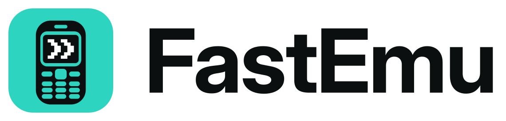
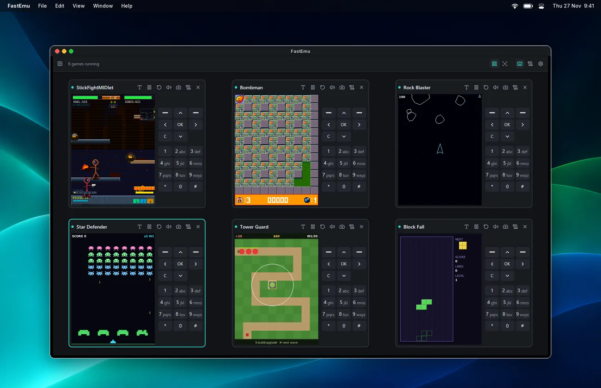
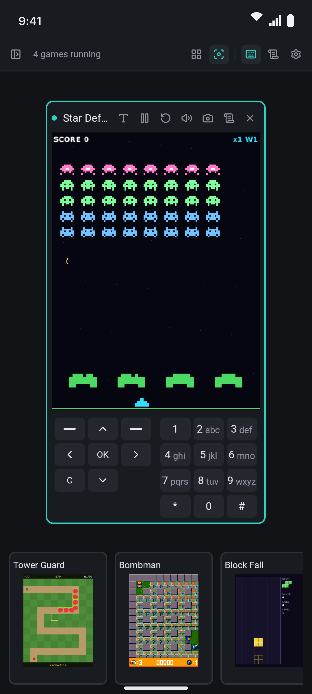

<p align="center">
  <picture>
    <source media="(prefers-color-scheme: dark)" srcset="assets/logo-dark.svg">
    <source media="(prefers-color-scheme: light)" srcset="assets/logo-light.svg">
    
  </picture>
</p>

<p align="center">
  Modern and faster version of MicroEmu and J2ME Loader with multi instances support, available in Windows, Linux, MacOS and Android built in Zed GPUI.
</p>

<p align="center">
  <a href="https://github.com/fzn0x/FastEmu/actions/workflows/ci.yml"></a>
  <a href="#license"></a>
  <a href="https://fastemu.functionx.dev"></a>
</p>

---

<p align="center">
  
  
</p>

<sub>Stick Fight, BombMan, Rock Blaster, Star Defender, Tower Guard and
Block Fall playing in the FastEmu 0.1.0 window, on a macOS desktop
mock-up, and the Android app on the Pixel 8 emulator. See
[Credits](#credits).</sub>

FastEmu runs Java ME games, the `.jar` and `.jad` files made for phones
of the 2000s, on Windows, Linux, macOS and Android. It implements CLDC 1.1
and MIDP 2.0 with a virtual machine of its own, so it needs no Java
installed. Each game runs in its own virtual machine with its own memory,
threads, saves and sound, and one window shows as many games as you start.
A game that crashes or hangs does not stop the ones next to it.

How it compares with MicroEmulator 2.0.4 on one Windows PC, in start
time, memory, processor time and many games at once, and where
MicroEmulator is faster, is on the [benchmark page](docs/benchmark.md).

[Install](#install) · [Usage](#usage) · [Supported APIs](#supported-apis) ·
[Build from source](#building-from-source) · [Contributing](CONTRIBUTING.md) ·
[Changelog](CHANGELOG.md) · [Bahasa Indonesia](README.id.md)

## Install

Download the file for your system from the
[Releases page](https://github.com/fzn0x/FastEmu/releases/latest). Each
release has a `SHA256SUMS` file to check the downloads against.

| System | What to do |
| --- | --- |
| Windows | Run `fastemu-<version>-windows-x64-setup.exe`. It installs FastEmu for your account without administrator rights. It adds FastEmu to the Start menu and to Open with for `.jar` and `.jad` files, and Settings, Apps uninstalls it. To skip installing, unpack `fastemu-<version>-windows-x64-portable.zip` anywhere and run `fastemu.exe`. If SmartScreen warns, choose More info, then Run anyway: the programs are not signed. |
| Linux | Make `fastemu-<version>-linux-x64.AppImage` executable and run it. Or install `fastemu-<version>-linux-x64.deb` on Debian and Ubuntu, or `fastemu-<version>-linux-x64.rpm` on Fedora and other RPM systems, for a menu entry. `fastemu-<version>-linux-x64.tar.gz` unpacks anywhere. Each comes for Arm64 too, as `-linux-arm64`. FastEmu needs a Vulkan driver and a Wayland or X11 session. If the AppImage says FUSE is missing, run it with `--appimage-extract-and-run`. |
| macOS | Open `fastemu-<version>-macos-universal.dmg` and drag FastEmu onto Applications. `fastemu-<version>-macos-universal.zip` holds the same app, to unpack and move there yourself. The app is not notarized: open it once from System Settings, Privacy & Security, Open Anyway. |
| Android | Open `fastemu-<version>-android.apk` from your files. Android asks you to allow installs from that source the first time. |
| Any Linux, sandboxed | Open `fastemu-<version>-linux-x64.flatpak` or `-linux-arm64.flatpak` with your software center, or run `flatpak install ./fastemu-<version>-linux-x64.flatpak`. The first time, Flatpak fetches the freedesktop runtime from Flathub. In its sandbox FastEmu sees the display, sound and the network, and only the files you pick. |

From a terminal, one line installs the latest release, checked against
its `SHA256SUMS`. On Linux, it installs for your account, with a menu
entry and the `fastemu` command in `~/.local/bin`. On macOS, it installs
FastEmu.app into Applications:

```sh
curl -fsSL https://github.com/fzn0x/FastEmu/releases/latest/download/install.sh | sh
```

On Windows, in PowerShell, it runs the setup:

```powershell
irm https://github.com/fzn0x/FastEmu/releases/latest/download/install.ps1 | iex
```

`sh install.sh --uninstall` removes FastEmu again, and so does
`install.ps1 -Uninstall`.

FastEmu does not include games. Use files you own or that their authors
made free to share.

## Usage

**Adding games.** Drag `.jar` or `.jad` files onto the window, choose **+**
at the top of the library, or pass the files on the command line, which
adds each one and starts it:

```sh
fastemu snake.jar tetris.jad
```

On Android, choose **+** and pick the files from storage, or open them
from a file manager with FastEmu. FastEmu reads the name, vendor, version
and icon from the manifest or the descriptor and lists the game in its
library. Click a game to start it.

**Running several games.** Start another game from the library while one
runs and it opens next to the first. You can start the same game twice;
each copy keeps its own saves. Every game plays its sound, and each can be
muted. The window shows the running games in a grid of equal tiles, or the
highlighted one large with the others in a strip beside it.

**Keys.** The keyboard plays the highlighted game:

| Phone key | Keyboard |
| --- | --- |
| 0 to 9 | `0` to `9` on the number row and the number pad |
| `*` and `#` | `*` and `#` (`Shift+8`, `Shift+3`), or the number pad's `*` and `/` |
| Up, down, left, right | Arrow keys |
| Fire | Enter or Space |
| Left and right soft keys | F1 and F2 |
| Clear | Backspace |

Every binding can be changed in the settings. Each game also has a phone
keypad under its screen, held by the mouse or a finger. Games on a touch
screen get clicks, taps and drags on their screen: pick a touch phone
profile, or turn on **Touch screen** in the game's settings. While a
game shows a text box, typing goes into it as text; on Android a dialog
with the system keyboard opens. The key codes a game sees come from its
phone profile, because phone makers used different codes: Nokia, Siemens
and Motorola layouts are built in.

**Without a window.** `fastemu run` runs a game for tests and scripts,
presses keys and touches the screen from a script, and saves the last
picture or every picture the game draws:

```sh
fastemu run snake.jar --frames 300 --keys "wait:1500 5" --screenshot snake.png
```

On Windows, type `fastemu` in Command Prompt or PowerShell, in FastEmu's
folder or with it on `PATH`: that runs `fastemu.com`, which waits for the
game and returns its exit code. `fastemu.exe` itself is the app, which
opens no console window. The setup puts both in
`%LOCALAPPDATA%\Programs\FastEmu`.

The [documentation](https://fastemu.functionx.dev/docs/) has the full
list of keys and shortcuts, the settings, the phone profiles, where saves
live and every option of `fastemu run`.

## Supported APIs

FastEmu targets the platform that games of that time were written for:

- CLDC 1.1 and its `java.lang`, `java.util` and `java.io` subset
- MIDP 2.0: the `Canvas`, the high-level screens (`Form` and its items,
  `List`, `TextBox`, `Alert` and `Ticker`), record stores and the MIDlet
  life cycle
- The MIDP 2.0 game API
- The Generic Connection Framework: HTTP, HTTPS, sockets and datagrams,
  for the games you allow network access, which is off by default. Text
  messages are never sent: a game that sends one is told it failed.
- Mobile Media API (MMAPI, JSR 135): tones, WAV, MIDI, MP3 and AMR
- Nokia UI API: `FullCanvas`, `DirectGraphics`, `DirectUtils`,
  `DeviceControl` and `Sound`, on the Nokia, Sony Ericsson and generic
  phone profiles
- Siemens' game and colour game packages on the Siemens profile, and
  Motorola's backlight class on the Motorola profile

3D games (JSR-184), file connections (JSR-75), Bluetooth and the rarer
vendor APIs do not work yet. The
[compatibility page](docs/compatibility.md) has the details and the free
games FastEmu was run with. A game that does not work belongs in a
[game report](https://github.com/fzn0x/FastEmu/issues/new?template=game_report.yml).

## Building from source

You need [rustup](https://rustup.rs). The repository pins its toolchain in
`rust-toolchain.toml`, so the right Rust installs on the first build.

```sh
git clone https://github.com/fzn0x/FastEmu.git
cd FastEmu
cargo test            # the emulator crates
cargo run -p fastemu  # the desktop app
```

On Linux the desktop app also needs a C compiler, `pkg-config`, the ALSA
headers for its sound and the development packages of GPUI: fontconfig,
xkbcommon, Wayland, X11 and Vulkan. On macOS the desktop app
needs Xcode, whose Metal toolchain compiles GPUI's shaders. Many tests
compile small Java programs, and the virtual machine's tests compare its
results with a real JVM's, so install a JDK 9 or newer; CI uses 17.
[CONTRIBUTING.md](CONTRIBUTING.md) has the exact packages, and
[docs/building-android.md](docs/building-android.md) the Android app's
steps.

## How it is built

A Rust workspace of small crates. `fastemu-core` holds the types that the
runtime and the apps share: frames, input events, device profiles and the
launcher that starts a game. `fastemu-jvm` is the virtual machine and its
class libraries, `fastemu-gfx` the 2D graphics, `fastemu-audio` sound and
MIDI, and `fastemu-midp` the MIDP, game, media, network and vendor APIs
that games call. `fastemu-ui` is the GPUI interface that the desktop
program `fastemu` and the Android app `fastemu-android` both use, and
`gpui_android` is GPUI's Android backend.

## Credits

[MicroEmulator](https://github.com/barteo/microemu) and
[J2ME Loader](https://github.com/nikita36078/J2ME-Loader) kept these games
playable for more than ten years. FastEmu follows their behavior where a
game depends on it, and owes them the knowledge of which quirks matter.

The interface is built with [GPUI](https://github.com/zed-industries/zed),
the UI framework of the Zed editor. GPUI on Android runs on the Zed Android
port by Dylan Murzello.

The pictures at the top show free games, all under the MIT License:
[Stick Fight](https://github.com/Dahmalahi/STICK-FIGHT-OFFICIEL-REPO) by
Dash Animation V2,
[BombMan](https://github.com/yaricom/bombman-RL-AI-J2ME) by Iaroslav
Omelianenko, and Rock Blaster, Star Defender, Tower Guard and Block Fall
from [J2ME 100 Games](https://github.com/agneay/j2me-100-games) by Agneay
B Nair and the J2ME Game Archive contributors. The desktop wallpaper was
rendered with GPT Image 2.6 on Higgsfield.

The Rust crates, fonts and game frames FastEmu uses, with their licenses,
are listed in [THIRD_PARTY_NOTICES.md](THIRD_PARTY_NOTICES.md). The people
who helped are in [CONTRIBUTORS.md](CONTRIBUTORS.md).

## License

FastEmu is free software under the [GNU General Public License v3.0 or
later](LICENSE).
